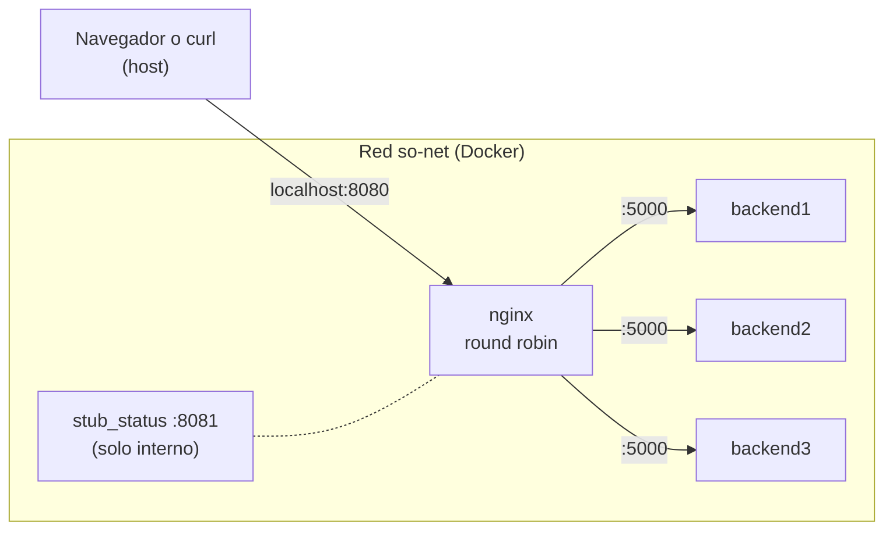

<div align="center">

# Tríada

**Tres backends Flask detrás de Nginx, con balanceo de carga y monitoreo con Prometheus y Grafana, todo en Docker.**


Proyecto final de Sistemas Operativos · Universidad Autónoma de Occidente (UAO) · 2026

</div>

---

## Qué hace

1. Nginx recibe las peticiones en `http://localhost:8080` y las reparte en turnos (round robin) entre tres instancias del backend.
2. Cada instancia responde con su número, así se ve a cuál fue cada petición.
3. Cada instancia expone `/metrics` con la cantidad de peticiones y su duración.
4. Prometheus recolecta esas métricas, las de Nginx y las de cada contenedor; Grafana las muestra en un dashboard.

## Estado del proyecto

| Pieza | Fase | Estado |
| --- | --- | --- |
| Backends Flask con métricas | 1 · Manuel | ✅ listo |
| Nginx con balanceo y `stub_status` | 1 · Manuel | ✅ listo |
| `docker-compose.yml` base y CI | 1 · Manuel | ⏳ en curso |
| Prometheus, exporter, cAdvisor y Grafana | 2 · Christian | ⏳ pendiente |
| Pruebas de carga con k6 | 3 · Eddie | ⏳ pendiente |

## Arquitectura



Solo Nginx publica un puerto al host (`8080`). Los tres backends son la misma imagen Flask con distinto `INSTANCE_ID` y escuchan en el `5000` dentro de la red `so-net`; desde el host no se puede llegar a ellos. Nginx reparte las peticiones en turnos y, si un backend no responde, reintenta en el siguiente. El `stub_status` del puerto `8081` también es interno: lo leerá el exportador de Nginx en la Fase 2.

## Puesta en marcha

### Requisitos

- [Docker Desktop](https://www.docker.com/products/docker-desktop/) encendido (incluye Docker Compose v2).
- Git.
- El puerto `8080` libre. Si el laboratorio anterior (`lab-proxy`) está levantado, bájalo antes.
- Solo para correr las pruebas del backend: Python 3.12.

### 1. Clonar el repositorio

```powershell
git clone https://github.com/Davidev77/ProyectoFinalSO.git
cd ProyectoFinalSO
```

### 2. Levantar la infraestructura

```powershell
docker compose up -d --build --wait
```

`--wait` espera a que los tres backends pasen su healthcheck; Nginx arranca después de ellos.

### 3. Verificar que todo funciona

```powershell
docker compose ps                     # 4 servicios; backend1..3 "healthy"
curl.exe -s http://localhost:8080/
```

```json
{"contenedor":"ab368547842f","instancia":"1","mensaje":"Hola desde la instancia 1"}
```

También se puede abrir http://localhost:8080 en el navegador.

## URLs de acceso

| Servicio | URL | Credenciales |
| --- | --- | --- |
| Aplicación (Nginx) | http://localhost:8080 | — |
| Prometheus | Pendiente · Fase 2 | — |
| Grafana | Pendiente · Fase 2 | Pendiente · Fase 2 |
| cAdvisor | Pendiente · Fase 2 | — |

## Verificar el balanceo de carga

Nueve peticiones seguidas se reparten 3 / 3 / 3:

```powershell
1..9 | ForEach-Object { (curl.exe -s http://localhost:8080/ | ConvertFrom-Json).instancia }
# 1 2 3 1 2 3 1 2 3
```

Cada respuesta trae la cabecera `X-Upstream` con la IP y el puerto del backend que la atendió:

```powershell
curl.exe -si http://localhost:8080/ | Select-String "X-Upstream"
# X-Upstream: 172.18.0.2:5000
```

El log de Nginx muestra lo mismo por cada petición, con su tiempo:

```powershell
docker compose logs nginx --tail 5
# ... "GET / HTTP/1.1" estado=200 instancia=172.18.0.2:5000 tiempo=0.002 upstream_tiempo=0.003
```

Para ver la tolerancia a fallos, detén un backend y repite las peticiones: siguen respondiendo los otros dos, sin errores.

```powershell
docker compose stop backend2
1..6 | ForEach-Object { (curl.exe -s http://localhost:8080/ | ConvertFrom-Json).instancia }
docker compose start backend2
```

## Monitoreo

> Pendiente · Fase 2 (Christian): cómo revisar los targets de Prometheus y abrir el dashboard «Infraestructura SO».

## Pruebas de carga

> Pendiente · Fase 3 (Eddie): instalar k6, comando para correr la prueba y cómo leer el resultado.

## Comandos

Comandos en PowerShell, desde la raíz del repo. Usa `curl.exe`: en PowerShell, `curl` es un alias de otro comando.

| Comando | Para qué |
| --- | --- |
| `docker compose up -d --build --wait` | Construir y levantar todo |
| `docker compose ps` | Estado de los servicios |
| `docker compose logs nginx --tail 20` | Log de balanceo (`instancia=`, `tiempo=`) |
| `docker compose exec nginx wget -qO- http://127.0.0.1:8081/stub_status` | Ver `stub_status` desde dentro de Nginx |
| `docker compose exec backend1 whoami` | Comprobar que el backend no corre como root (`triada`) |
| `docker stats --no-stream` | CPU y memoria de cada contenedor (límite de 256 MiB por backend) |
| `curl.exe -s "http://localhost:8080/lento?ms=300"` | Respuesta lenta a propósito (máximo 2000 ms) |
| `docker compose stop backend2` · `docker compose start backend2` | Simular la caída de un backend |
| `docker compose down` | Bajar todo |
| `cd backend; python -m pytest tests -v` | Pruebas del backend (con `.venv` activo) |
| `ruff check backend` | Estilo y errores de Python |
| `Get-Content backend/Dockerfile \| docker run --rm -i hadolint/hadolint:v2.15.1` | Revisar el Dockerfile |

Para preparar el entorno de pruebas una sola vez:

```powershell
py -3.12 -m venv .venv
.\.venv\Scripts\Activate.ps1
pip install -r backend/requirements.txt pytest==9.2.0 ruff==0.17.5
```

## Integración continua

> Pendiente · Fase 1 (Manuel): qué revisa el pipeline en cada pull request.

## Estructura

```
backend/            app Flask, Dockerfile y pruebas
nginx/              nginx.conf
monitoring/         Prometheus y Grafana (Fase 2)
k6/                 pruebas de carga (Fase 3)
docs/               CONTRATO.md y documentos de diseño
.github/workflows/  CI
docker-compose.yml
```

## Flujo de trabajo

- `main` solo recibe la entrega final; el trabajo se integra en `develop`.
- Cada fase trabaja en su rama (`fase1-base`, `fase2-monitoreo`, `fase3-carga`) y abre un pull request hacia `develop`.
- El CI debe estar en verde para fusionar.
- Los nombres compartidos entre fases (servicios, puertos, métricas) están en [`docs/CONTRATO.md`](docs/CONTRATO.md).

## Documentación

| Documento | Contenido |
| --- | --- |
| [`docs/CONTRATO.md`](docs/CONTRATO.md) | Servicios, puertos, rutas y métricas que comparten las fases |
| [Informe (Google Docs)](https://docs.google.com/document/d/1MPO4G44Ge-d0srosCop8E2RMMqkFC38_iHEAW0BXBCg/edit) | Informe del proyecto en formato APA 7 |

## Autores

Eddie Santiago Delgado Campo · Christian David Home Acero · Manuel Betancurt Pérez

## Licencia

Proyecto académico (Sistemas Operativos, UAO, 2026). Sin licencia definida.
